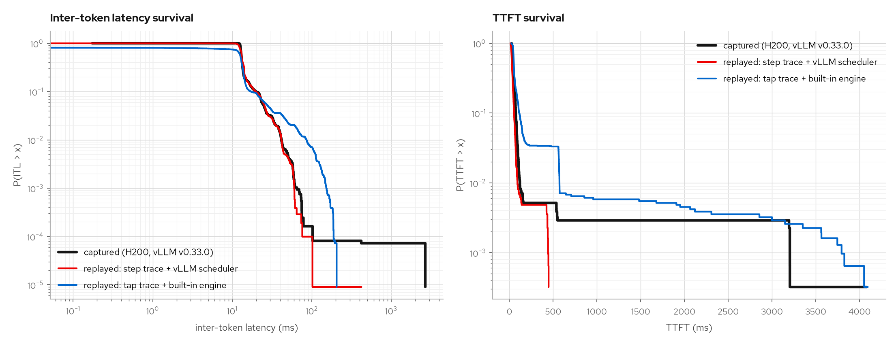

# vllm-vcr

Record, play, and inspect vLLM **V1 engine-core** traces. One binary, three
subcommands (the VCR metaphor):

- **`record`** taps a live vLLM frontend ↔ engine-core link (a transparent ZMQ
  proxy) and writes a JSONL trace.
- **`play`** runs a mock engine-core backend that speaks the real ZMQ + msgpack
  protocol, replaying a trace or simulating from a latency model. No model weights,
  no GPU. With the `nixl` feature it also moves simulated KV-cache bytes between
  prefill and decode over [NIXL](https://github.com/ai-dynamo/nixl).
- **`inspect`** converts benchmark reports, summarizes traces, renders Perfetto
  timelines, and runs calibration.

It runs behind vLLM's Rust or Python frontend unchanged: the frontend still owns
tokenization, chat templates, tool calling, streaming, and OpenAI-compatible request
handling; `vllm-vcr` replaces only the model backend.

## Documentation

**📖 Full docs: <https://neuralmagic.github.io/vllm-vcr/>**

The site covers architecture, install, the quick start, trace replay and
calibration, versioning and conformance, and operations. Source lives in
[`docs/`](docs/) and is built with [mdBook](https://rust-lang.github.io/mdBook/).

## Install

Requires Rust 1.94.1 or newer. From a checkout:

```bash
cargo install --path . --locked
```

That installs the single `vllm-vcr` binary. See the
[Install guide](https://neuralmagic.github.io/vllm-vcr/install.html) for the
NIXL-enabled build, the container image, and installing from Git.

## Quick start

```bash
# Run the mock engine; point a vLLM frontend at the same handshake address.
vllm-vcr play --handshake-address tcp://127.0.0.1:29550 --log-requests
```

Full walkthrough (frontend wiring, prefill/decode smoke, capture and replay) in the
[Quick start](https://neuralmagic.github.io/vllm-vcr/quick-start.html).

## Engine-step capture

`play --use-rust-core` drives vLLM's Rust scheduler, and can price each step from
steps recorded inside a real engine (`--step-trace`). The recorder is one Python
file loaded with `--scheduler-cls`:

```bash
just capture-up                 # 1x GPU rig: loadgen, vllm-rs, tap, headless vLLM
just capture-steps-on           # restart the engine with the step recorder
just capture-run                # drive load; fetch tap trace and engine-steps.jsonl
just capture-down               # release the GPU
just replay-step-capture /tmp/trace-capture-h200/engine-steps.jsonl
```

Measured on one H200 with vLLM v0.33.0 and Qwen3-8B (2026-11-12):

- Recorder on versus off: no effect visible. Median step gap at concurrency 1 was
  12.12 to 12.74 ms across recorder-off pods and 12.32 ms with the recorder on;
  throughput at concurrency 16 was 24.82 to 25.48 req/s off and 24.97 req/s on.
  Pod-to-pod spread (about 0.6 ms per step) is the resolution of the comparison.
- Trace versus vLLM's own counters under sync scheduling: draft tokens
  125,060 = 125,060, accepted drafts 81,233 = 81,233, prefill tokens
  698,930 = 698,930 (873 requests).
- Replaying the capture: median decode step 12.30 ms against 12.31 ms captured
  at concurrency 1, and 12.99 ms against 12.80 ms at 16.
- Against the tap-trace replay on the built-in engine, same capture and
  schedule: worst ITL quantile error 0.9% instead of 51.7%, worst request decode
  time error 1.6% instead of 15.0%. TTFT under load is 14 ms short (28.6 ms
  against 42.9 ms), about one step, because the capture ran async scheduling.
- KV transfers on a prefill/decode pair joined by NIXL (`just capture-kv-up`):
  the trace has 104 completed and 6 failed loads where vLLM's metrics count 104
  and 6, and the same 20,864 blocks the prefill handed over. Replayed loads take
  the time and outcome of a captured load of their size.



Method, full tables and limits:
[Step recorder on a GPU](docs/trace-replay/step-recorder-report.md). Format and
flags: [Engine-step traces](docs/trace-replay/step-trace.md).

## Contributing

Run `cargo fmt` and `cargo clippy --all --benches --tests --examples --all-features`
before sending a change; CI runs the same plus the per-vLLM-line conformance suite
(see [`.github/workflows`](.github/workflows)).

## License

Dual-licensed under [Apache-2.0](LICENSE-APACHE) or [MIT](LICENSE-MIT), at your option.
