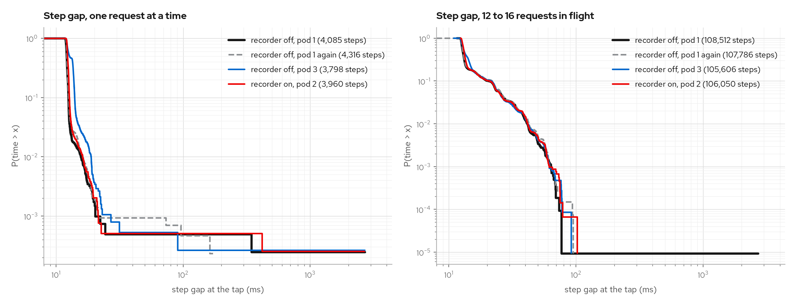
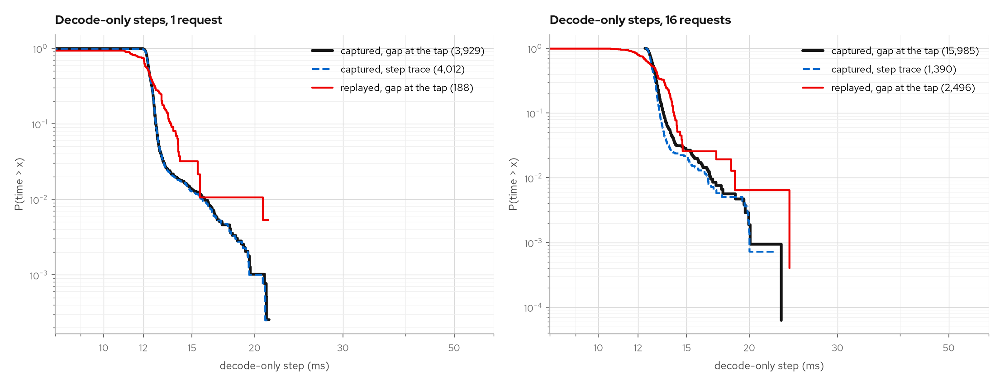
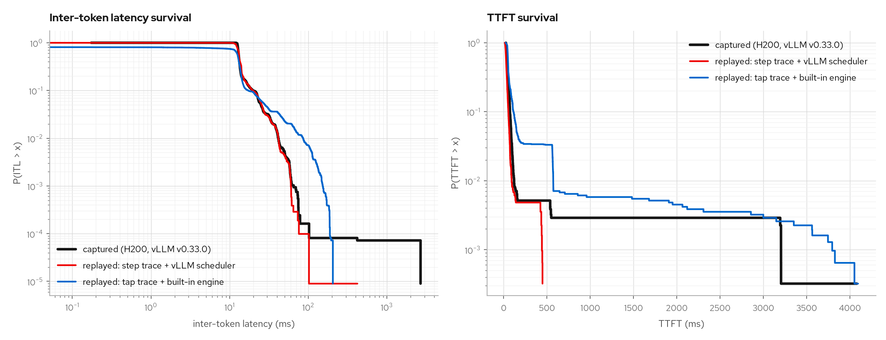
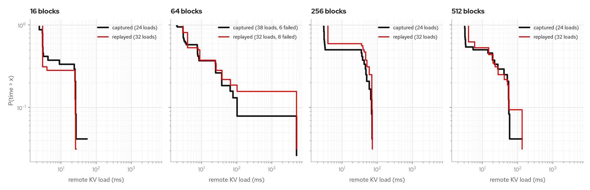

# Step recorder on a GPU: measured cost and accuracy

Two capture sessions on one GPU each, 2026-11-12. They answer five questions
about [`vcr_step_recorder.py`](./step-trace.md): does turning it on change the
engine's latency, does its trace agree with what the tap and vLLM's own stats
saw, does the trace replay to the recorded step times, is that replay closer to
the capture than the tap-trace replay it sits beside, and do its KV transfer
records match a real prefill/decode pair.

## Setup

| | |
| --- | --- |
| Rig | `deploy/trace-capture/base/h200-capture.yaml`: loadgen → `vllm-rs` → tap → headless vLLM |
| GPU | 1x NVIDIA H200 (CoreWeave `gd-8xh200ib-i128`), every run on the same node |
| Engine | `vllm/vllm-openai:v0.33.0`, `Qwen/Qwen3-8B`, `--enforce-eager`, ngram speculative decoding with 4 drafts |
| Scheduling | async (`AsyncScheduler`), vLLM's default for this config |
| Tap, frontend | `ghcr.io/neuralmagic/vllm-vcr:vllm0.33` |
| Load | `run-capture.sh`: 60 s closed loop at concurrency 1, then 120 s at 16; 795-token prompts, 128 output tokens, fixed seed |

The recorder can only be switched by restarting the engine, so an off/on
comparison is also a comparison between two pods. Five pods ran the load, in the
order off, on, off, on, on. Two were lost to preemption by another workload:
one mid-load (no data), one after its load finished and before its tap trace was
fetched (client-side numbers only).

## Latency with the recorder off and on

Step gaps as the tap saw them at the engine socket (`itl_ms` of the tap trace):

| Run | Pod | Recorder | c=1 requests | c=1 gap p50 / p90 / p99 (ms) | c>=12 requests | c>=12 steps | c>=12 gap mean / p50 / p90 / p99 (ms) |
| --- | --- | --- | --- | --- | --- | --- | --- |
| off1 | 1 | off | 118 | 12.12 / 12.51 / 15.68 | 3033 | 108,512 | 14.86 / 12.85 / 20.50 / 41.41 |
| off2 | 1 | off | 122 | 12.17 / 12.59 / 16.21 | 3018 | 107,786 | 14.99 / 12.90 / 21.88 / 42.80 |
| on1 | 2 | on | 114 | 12.32 / 12.73 / 16.17 | 2969 | 106,050 | 15.07 / 13.15 / 20.83 / 41.72 |
| off3 | 3 | off | 109 | 12.74 / 14.01 / 18.89 | 2954 | 105,606 | 15.19 / 13.21 / 21.51 / 41.51 |

What the load generator saw through `kubectl port-forward`:

| Run | Recorder | c=1 mean ITL p50 (ms) | c=16 requests in 120 s | c=16 req/s | c=16 TTFT p50 (ms) | c=16 mean ITL p50 (ms) |
| --- | --- | --- | --- | --- | --- | --- |
| off1 | off | 11.7 | 3053 | 25.44 | 76 | 14.4 |
| off2 | off | 11.9 | 3057 | 25.48 | 82 | 14.6 |
| on1 | on | 12.0 | 2996 | 24.97 | 80 | 14.6 |
| off3 | off | 12.5 | 2978 | 24.82 | 80 | 14.7 |
| on4 | on | 11.9 | 2996 | 24.97 | 79 | 14.7 |



Two recorder-off pods differ from each other by 0.62 ms (5%) in the median step
gap at concurrency 1 and by 2.6% in throughput at concurrency 16. Both
recorder-on pods fall between them on every column. Two runs on the same pod
(off1, off2) agree within 1%.

So this method shows no recorder effect, and cannot resolve one smaller than the
pod-to-pod spread of about 0.6 ms per step. The engine-thread cost measured
without a GPU is about 1 µs per step ([Cost on the engine](./step-trace.md#cost-on-the-engine)).

## The trace against the tap and vLLM's stats

Run on1 (async scheduling, 3109 requests, 11,783 executed steps):

| Quantity | Step trace | Independent source |
| --- | --- | --- |
| Requests finishing prefill | 3109 | 3109 requests in the tap trace |
| Prefill tokens | 2,448,286 | 2,448,274 prompt minus cached tokens in the tap trace |
| Decode-only step time at 1 request, p50 | 12.31 ms (4012 steps) | 12.32 ms tap gap p50 at concurrency 1 |
| Decode-only step time at 12+ requests, p50 | 13.07 ms (5263 steps) | 13.15 ms tap gap p50 at concurrency 12+ |
| Draft tokens | 453,716 | 443,820 in vLLM's `spec_decoding_stats` |

The 12-token prefill difference is unexplained. The draft-token excess is
9,896, which is 2,474 request-steps of 4 drafts: under async scheduling the
runner executes steps for requests that have already finished, and vLLM's
`update_from_output` skips those when it counts. The trace counts what the
runner executed.

A 45 s run at concurrency 16 with `--no-async-scheduling`, where no such steps
exist (873 requests, 2163 executed steps):

| Quantity | Step trace | vLLM / tap |
| --- | --- | --- |
| Draft tokens | 125,060 | 125,060 |
| Accepted drafts | 81,233 | 81,233 |
| Prefill tokens | 698,930 | 698,930 |
| Sampled tokens | 113,371 | 111,744 emitted |

The 1,627 sampled tokens that were not emitted are the ones the scheduler trims
past a length stop.

The first sync run reported 78,567 accepted against vLLM's 80,233. The recorder
was reading the sampled-token lists on its background thread, after the
scheduler had trimmed them in place. It now takes their lengths on the engine
thread before the scheduler runs, and the table above is from the fixed
recorder. Run on1 predates the fix, so its accepted and sampled counts are not
listed.

## Replaying the capture

`just replay-step-capture <engine-steps.jsonl>` replays the trace on
`play --use-rust-core --step-trace`, four waves at each concurrency, and
compares the decode-only step gaps the tap sees with the decode-only step times
recorded at the same concurrency. For run on1:

| Decode concurrency | Captured p50 / p90 | Replayed p50 / p90 |
| --- | --- | --- |
| 1 | 12.31 / 12.71 ms (4012 steps) | 12.30 / 13.63 ms (188 gaps) |
| 16 | 12.80 / 13.25 ms (1390 steps) | 12.99 / 14.17 ms (2496 gaps) |



The step trace and the tap lie on each other. The replay matches the median and
is about 1 ms wider at p90. That width is the replay host's timer: at a constant
12 ms target on the same laptop, both engines deliver gaps of about 11.1 to
13.0 ms (p10 to p90).

The first replay was wider still, 14.4 and 15.4 ms at p90. The scheduler-backed
engine ran on a timer-only tokio runtime, whose sleeps are coarser on macOS than
the I/O driver's; at a constant 12 ms target it delivered 10.0 to 13.9 ms where
the built-in engine delivered 11.2 to 13.1 ms. Its runtime now has the I/O
driver and the two engines match. This was measured on macOS only.

## Replay accuracy against the tap-trace approach

Both replays take run on1's arrival schedule (3109 requests over 180 s: 60 s at
concurrency 1, then 120 s at 16) and run it in real time through
`inspect calibrate-e2e --replay-arrivals`. The client-side measurements are
compared with the capture's tap trace.

- **Tap trace + built-in engine**: the simulator's own scheduler, with a latency
  model fitted from the capture's tap trace.
- **Step trace + vLLM scheduler**: `--use-rust-core --step-trace`, steps priced
  from the capture's engine-step trace. Burst sizes still come from the tap
  trace.

| Pooled, 3109 requests | Captured | Tap trace + built-in engine | Step trace + vLLM scheduler |
| --- | --- | --- | --- |
| ITL p50 / p90 / p99 (ms) | 13.13 / 19.84 / 41.56 | 12.79 / 17.21 / 86.04 | 13.20 / 19.66 / 41.54 |
| Request decode time p50 / p90 / p99 (ms) | 517 / 687 / 836 | 445 / 587 / 710 | 515 / 688 / 822 |
| TTFT p50 / p90 / p99 (ms) | 42.3 / 71.4 / 119.7 | 50.8 / 113.2 / 571.8 | 28.4 / 53.1 / 91.1 |
| TTFT at concurrency 1, p50 / p90 (ms) | 25.9 / 28.3 | 28.7 / 51.7 | 27.4 / 33.9 |
| Worst ITL quantile error | | 51.7% | 0.9% |
| Worst request decode time error | | 15.0% | 1.6% |
| Worst TTFT quantile error | | 79.1% | 32.9% |

The errors are `calibrate-e2e`'s: the largest relative error over its
concurrency cells and p50, p90 and p99.



Step timing and request duration follow the capture to within 2%. TTFT under
load does not: 28.6 ms at p50 where the capture has 42.9 ms, 14.3 ms short, which
is about one step (13.2 ms). The capture ran async scheduling, where vLLM
schedules a step before the one before it has finished, so a new arrival waits a
step longer. The simulator schedules each step after the previous one
completes; the Rust scheduler has an `async_scheduling` setting the simulator
does not use yet.

A capture taken with `--no-async-scheduling` bears that out. It is the 45 s
run at concurrency 16 from the draft-count check (873 requests, 865 of them at
concurrency 9 to 16), replayed the same two ways:

| Concurrency 9 to 16 | Captured | Tap trace + built-in engine | Step trace + vLLM scheduler |
| --- | --- | --- | --- |
| Async capture, TTFT p50 / p90 (ms), 2988 requests | 42.9 / 71.5 | 51.1 / 115.3 | 28.6 / 53.3 |
| Sync capture, TTFT p50 / p90 (ms), 865 requests | 38.1 / 63.4 | 52.0 / 78.2 | 40.7 / 73.9 |
| Sync capture, ITL p50 / p90 / p99 (ms) | 13.04 / 23.92 / 54.72 | 12.88 / 14.58 / 25.47 | 13.30 / 24.50 / 56.32 |
| Sync capture, request decode time p50 / p90 (ms), all 873 | 603 / 796 | 470 / 634 | 619 / 802 |

With sync scheduling on both sides the step-trace replay's TTFT under load is
2.6 ms above the capture at p50, where it was 14.3 ms below on the async
capture. This capture starts cold, so its first 16 requests waited on steps of
3,626 and 2,656 ms. Those two steps are removed from the step trace, and those
16 requests from the tap trace the built-in engine's model is fitted on; the
capture's own p99s still contain them, so only p50 and p90 are compared for
TTFT and request decode time.

The step-trace numbers have one record removed: the engine's first step, which
took 4,079 ms. Left in, a replay can draw it for any 795-token prefill on an idle
engine, and with open-loop arrivals the stall queues the requests behind it:
TTFT at concurrency 1 went to 1,374 ms at p90. With that record in, the worst
ITL error was 2.4% and the worst request decode time error 1.2%.

```bash
RIG=(--sim-arg=--max-num-seqs --sim-arg=1024 --sim-arg=--max-num-batched-tokens
     --sim-arg=8192 --sim-arg=--max-model-len --sim-arg=16384
     --sim-arg=--kv-cache-size --sim-arg=65536)
vllm-vcr inspect calibrate-e2e tap-trace.jsonl --replay-arrivals "${RIG[@]}" \
    --dump-trace tap-replay.jsonl
vllm-vcr inspect calibrate-e2e tap-trace.jsonl --replay-arrivals "${RIG[@]}" \
    --sim-arg=--use-rust-core --sim-arg=--step-trace --sim-arg=engine-steps.jsonl \
    --dump-trace step-replay.jsonl
just compare "captured=tap-trace.jsonl" "step=step-replay.jsonl" "tap=tap-replay.jsonl"
```

## KV transfer records on a prefill/decode pair

| | |
| --- | --- |
| Rig | `deploy/trace-capture/base/pd-kv-capture.yaml`: one pod, a prefill and a decode vLLM sharing one H200 |
| Engines | `vllm/vllm-openai:v0.33.0`, `Qwen/Qwen3-8B`, `--enforce-eager`, async scheduling, 0.40 GPU memory each, recorder on both |
| Connector | `NixlConnector` in pull mode over UCX, `kv_producer` and `kv_consumer`, `kv_load_failure_policy` `recompute`, 12 s lease |
| Driver | `pd_kv_drive.py` inside the pod: prefill with one output token, then decode with the returned `kv_transfer_params`, 16 output tokens |
| Prompts | random token ids, 256, 1024, 4096 and 8192 tokens; 12 per size one at a time, then 12 per size four at a time |

115 prefill requests and 110 decode requests. Besides the 96 plain ones: 5 decodes
named a request id the prefill never used and 3 named a closed port for an
engine already connected (all 8 loaded normally), 3 named an unknown engine at
a closed port (the handshake fails), 3 named block ids the prefill does not have
(the transfer fails), and 5 prefills were never decoded (the lease expires).

The decode engine's trace against vLLM's NIXL metrics and the driver:

| Quantity | Step trace | Independent source |
| --- | --- | --- |
| Loads completed | 104 | 104 in `vllm:nixl_xfer_time_seconds_count` |
| Loads failed | 6 | 6 in `vllm:nixl_num_failed_transfers_total` |
| Blocks per load | 20,864 over 104 loads | the same multiset as the `remote_block_ids` the prefill returned, and `prompt_tokens // 16` for every load |
| Bytes per traced block | | 49,224,351,744 bytes in `vllm:nixl_bytes_transferred_sum`, which is 2,359,296 per block exactly (36 layers of 65,536) |
| Mean load time | 21.35 ms `wall_ms` | 15.25 ms transfer plus 3.47 ms post |

`wall_ms` runs from the step whose connector metadata names the load to the
step whose output reports it, so it is the time the scheduler waited, not the
copy alone. One at a time, the median was 3.0 to 3.2 ms at every size (12 loads
each), where vLLM logged 1.54 ms transfer plus 0.28 ms post on average over its
first 37 transfers. Four at
a time, the medians were 24.4, 37.5, 49.2 and 46.2 ms for 16, 64, 256 and 512
blocks.

The three failed handshakes are `failed` records of 5,006 to 5,013 ms, vLLM's
handshake timeout. The three bad block lists are `failed` records of 2.0 to
3.4 ms. All six requests were recomputed and returned their 16 tokens.

The prefill engine's trace has 115 send records for 115 prefill requests. vLLM
counted 16 of them as expired (`vllm:nixl_num_kv_expired_reqs_total`): the 5
never decoded, the 5 with a wrong request id, and the 6 failed loads. The trace
shows those 16 as `ok` sends lasting about 12,000 ms. Expiry is not visible at
this boundary.

`just replay-kv-capture <decode-steps.jsonl>` replays 32 loads of each captured
size on a decode `play --use-rust-core` engine and records them again. All 128
replayed loads took the time of a captured load of the same size and outcome,
within -1 to +5 ms (the simulator's clock is in whole milliseconds). 8 of the 32
replayed 64-block loads failed and were recomputed, where 6 of the 38 captured
ones did.



Each size has two groups of loads: about 3 ms one at a time, and tens of
milliseconds four at a time. The 64-block panel's tail at 5 s is the failed
handshakes.

## What this does not show

- One GPU model, one node, one model, eager mode. Nothing about CUDA graphs,
  larger batches, tensor parallelism or other schedulers.
- Three recorder-off runs on two pods and two recorder-on runs on two pods. That
  bounds the effect by the pod-to-pod spread, it does not measure it.
- The recorder-on run with tap-side data (on1) used the recorder before the
  sampled-length fix. The fixed recorder has client-side numbers only (on4).
- The KV capture ran both engines in one pod on one GPU, over UCX without RDMA.
  Its load times are for a GPU-local copy and say nothing about a transfer
  between nodes. Pull mode only, no tensor parallelism, 104 completed loads.
- The KV replay check matches each replayed load to some captured load of its
  size. It does not compare distributions, and it prices by block count alone.
- The replay check compares decode-only steps at two concurrencies, not mixed
  prefill and decode steps, and only its median is asserted.
- The comparison with the tap-trace approach is two captures and one replay of
  each kind per capture, each fitted on the capture it replays, on a laptop. It
  says nothing yet about replaying a workload other than the one captured. The
  sync-scheduling capture is 45 s at one concurrency.

## Reproducing

```bash
just capture-up                       # recorder off
OUT_DIR=/tmp/recorder-off just capture-run
just capture-steps-on                 # restarts the engine with the recorder
OUT_DIR=/tmp/recorder-on just capture-run
just capture-down

just summarize /tmp/recorder-off/tap-trace.jsonl
just summarize /tmp/recorder-on/tap-trace.jsonl
just replay-step-capture /tmp/recorder-on/engine-steps.jsonl
```

The prefill/decode capture:

```bash
just capture-kv-up                    # one GPU, prefill and decode with the recorder
just capture-kv-run                   # drive P/D requests, fetch traces and /metrics
just capture-kv-down
just check-kv-capture                 # trace against vLLM's NIXL metrics
just replay-kv-capture /tmp/pd-kv-capture/decode-steps.jsonl
```

The figures: run the two replay recipes with `VCR_REPLAY_OUT=<dir>` so they keep
their traces, then `uv run scripts/plot_step_capture.py` (its docstring has the
flags).

Pin the pod to one node (`nodeSelector`) before comparing, and repeat the
recorder-off run on a fresh pod to see the pod-to-pod spread on your hardware.
